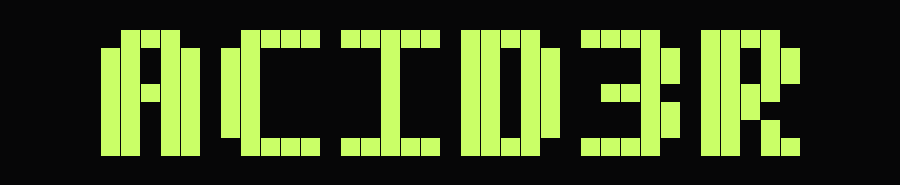
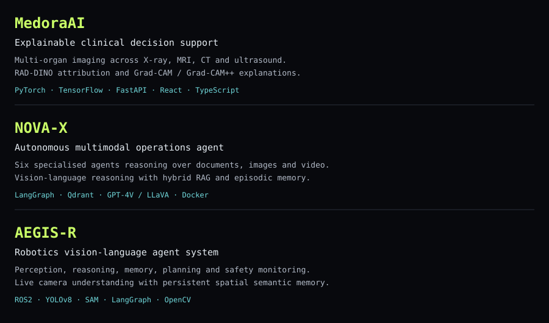
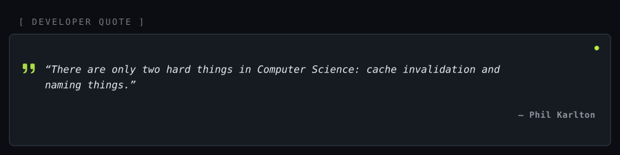
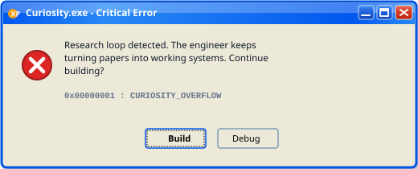

<picture>
  <source media="(max-width: 600px)" srcset="./assets/surveillance-header-mobile.svg" />
  
</picture>

 

<picture>
  <source media="(max-width: 600px)" srcset="./assets/aura-showcase-mobile.svg" />
  
</picture>

  

---

## RESEARCH & BUILDS

<picture>
  <source media="(max-width: 600px)" srcset="./assets/research-projects-mobile.svg" />
  
</picture>

---

# TECHNICAL STACK

### Core Technologies

 

### AI & Machine Learning

 

### LLM & AI Systems

 

### Robotics & Simulation

 

### Automation & Infrastructure

 

### Quantum Computing

---

## CONTRIBUTION SNAKE

  

---

## GITHUB TROPHIES

  

 

  

